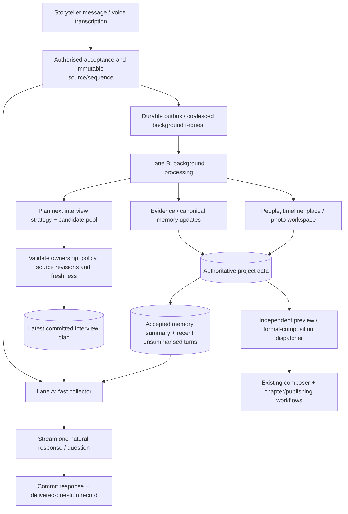

# CopyMe2 Memoir — Two-Lane Collector and Background Planning Refactor

**Status:** Implementation plan / proposed design (not yet implemented)  
**Version:** 1.0  
**Prepared:** 16 October 2026  
**Repository:** [`bohui/copyme2.ai`](https://github.com/bohui/copyme2.ai)  
**Product:** CopyMe2 Memoir (`/memoir/*`)  
**Primary outcome:** Faster, natural Mira replies without weakening evidence-grounded memory capture, workspace consistency, or the memoir-composition gates.

## 1. Executive decision

Adopt **two asynchronous execution lanes** using the existing application, Codex worker and durable task infrastructure:

1. **Lane A — Mira Collector (interactive, high priority):** Immediately understands the latest accepted user message, follows the user's current direction, and streams one natural reply / relevant next question.
2. **Lane B — Memory, Workspace & Interview Planner (background, lower priority):** Incrementally updates evidence-linked memory, summaries, people, timeline, place/photo workspace and a small **next-turn interview plan**, including one of three internal strategies: `comfort`, `explore`, `shape`.

**Do not start two new Codex processes per user reply.** Use reusable runtime capacity and distinct logical work queues/threads; isolate resource pools further only if measurements justify it.

**Do not show mode-selection controls.** The strategies are internal interviewing policies, not a visible workflow or mandatory life-stage progression. **Lane B proposes the next stored strategy and question candidates; deterministic application code validates/commits the plan. Lane A may ignore stale/inappropriate candidates when the latest user message requires it.**

**Do not let the internal `shape` strategy unlock book composition.** Preview/full-composition triggers, purchase entitlements, consent, artifact eligibility, publishing and print approval remain independent server-owned processes.

## 2. Context and the specific problem

Currently, the collector contract can create two to five question candidates in the visible response call, select one, and decide `reply_only` versus `extract`. The repository already performs background extraction and workspace tasks, and supports a separate organiser thread / Temporal jobs. The requested refactor should **move reusable future question planning and stored strategy selection to the existing background pathway**, while keeping the ability to respond immediately to the latest message.

Expected benefits (to **measure**, not guarantee):

- Lower time to the **first meaningful text** and the **complete next question**.
- No expensive summarisation, source reconstruction, photo search, or chapter generation on the collector's critical path.
- Better continuity through a compact accepted summary plus a bounded unsummarised tail.
- Less repeated question generation and fewer redundant background model calls.
- Independent workspace updates without delaying or collapsing the live chat.

### Repository alignment (checked against `main`; reconfirm before editing)

| Existing code / document | Observed boundary | Planned change |
|---|---|---|
| [`apps/api/collector_prompt.py`](https://github.com/bohui/copyme2.ai/blob/main/apps/api/collector_prompt.py) | Compact visible-interview contract, with instruction not to research or compose in that pass | Split common instructions from small active-strategy instructions; preserve source/safety rules |
| [`apps/api/collector_configuration.py`](https://github.com/bohui/copyme2.ai/blob/main/apps/api/collector_configuration.py) | Server-owned model, effort, `legacy`/`compact-v1` prompt versions | Introduce a **feature-gated** prompt/runtime version without changing the shared upstream model policy |
| [`apps/api/interview_plan.py`](https://github.com/bohui/copyme2.ai/blob/main/apps/api/interview_plan.py) | Collector currently returns up to five candidates, chosen ID, `reply_only`/`extract`, and `conversation_phase` limited to `comfort`/`explore` in its plan schema | Separate **foreground immediate question** from **background candidate pool**; keep a compatibility adapter |
| [`apps/api/conversation_phase.py`](https://github.com/bohui/copyme2.ai/blob/main/apps/api/conversation_phase.py) | Versioned phase state with explicit preference fields; **automatic Shape currently rejected** | Introduce an internal strategy plan allowing automatic `shape`; preserve previously stated user pacing preferences as separate constraints |
| [`apps/api/agent_lock.py`](https://github.com/bohui/copyme2.ai/blob/main/apps/api/agent_lock.py) | Cross-replica user-turn lease | Keep foreground serialization; do **not** extend this lease across long background jobs |
| [`apps/api/codex_runtime.py`](https://github.com/bohui/copyme2.ai/blob/main/apps/api/codex_runtime.py) | Codex runtime, language context, project context and turn streaming | Inject latest accepted plan/context; detach expensive background work from the response's critical path |
| [`apps/api/interview_plan.py`](https://github.com/bohui/copyme2.ai/blob/main/apps/api/interview_plan.py) | `reply_only` versus `extract` already decided alongside foreground reply | Preserve an inexpensive foreground **work hint**; do not add a new classifier call |
| [`docs/Memory_Collection_Tasks.md`](https://github.com/bohui/copyme2.ai/blob/main/docs/Memory_Collection_Tasks.md) | Existing deterministic tasks, project/source guards, Temporal dispatch, organiser/collector separation | Reuse durable background orchestration, source versioning, leases, idempotency and task publication |
| [`README.md`](https://github.com/bohui/copyme2.ai/blob/main/README.md) | Current live stack, background memory/timeline/composer jobs and configurable free allowance | Do not create a competing memory store or alter package/preview policy |

**Important current configuration:** the README describes `MEMORY_SPARK_FREE_RECALL_ROUNDS` with a default of **20**. Earlier product prototypes used five free sessions. This refactor must use the **server's current configured completion/entitlement event**, never hard-code either number.

## 3. Target architecture



**Operational separation:**

- Lane A is on the user's interactive latency path. It uses a small input and streams quickly.
- Lane B never needs to finish for Lane A to answer the current message.
- Lane B may process multiple accepted turns together if backlog accumulates. It must **not omit turns**.
- The canonical event index, chat history, human corrections and media permissions remain authoritative; **Codex thread history and model-generated summaries are only derived context**.
- Existing memory/photo/organiser jobs remain in place. The proposed planner should be a bounded stage within background processing, not a second independent whole-memoir system.

## 4. Ownership and permissions

| Concern | Lane A | Lane B | Application/server |
|---|---|---|---|
| Latest-message understanding | Required | May analyse afterwards | Supplies accepted input |
| User-facing acknowledgement | **Owns** | Never | Streams/persists permitted output |
| Immediate next question | **Owns**, including safe fallback | Prepares candidates | Records the **question actually delivered** |
| Long-term next-turn strategy | Reads, may locally deviate | **Proposes** `comfort`/`explore`/`shape` | **Validates and commits** |
| Personalised question pool | Select/adapt only; bounded fallback | **Owns generation and refresh** | Versioned store + policy filter |
| Evidence extraction / memory summary | Only a small work hint | **Owns** | Validates sources/revisions and persists |
| Timeline / people / location / photos | Does not block reply for them | **Owns derived updates** | Validates eligibility, identity and permissions |
| User language, privacy, exclusion, correction | Must honour immediately | Reconciles derived data | **Authoritative** |
| Free quota, payment, consent, composition trigger | Cannot grant | Cannot grant | **Authoritative** |
| Draft approvals, publishing, print submission | Cannot approve | Cannot approve | Explicit application flow / authorised human |

No new UI mode selector. No user-visible labels such as “You are in Shape.”

## 5. Three internal interview strategies

The strategy is a **planning hint**, not a lifecycle stage, source of permissions, or psychological assessment. All strategies retain Mira's journalist principles, adult-to-adult respect, warm tone, and one-main-question rule.

| Strategy | Goal | Appropriate example | Do **not** infer |
|---|---|---|---|
| `comfort` | Offer low-pressure, easy entry into a topic | “What is a place you enjoy remembering?” | Short answers mean discomfort |
| `explore` | Deepen an event, person or detail already volunteered | “What happened on your first day at the shop?” | A rich answer means the narrator wants probing |
| `shape` | Clarify order, links, names and gaps among existing stories | “Was that before or after your move to Sydney?” | Any permission to generate or publish a book |

### Automatic selection principles (Lane B)

- First name-only or uncertain opening with no specific memory: prefer `comfort`.
- Rich first reply: recommend `explore` **immediately**; no three-turn/five-turn gating.
- Relevant unanswered detail: `explore`.
- Narratives with chronology, identity or relationship ambiguity: `shape`, when that clarification is useful.
- Recent “not today”, topic exclusion, preference for gentler pacing: honour that preference regardless of label; choose a less demanding question.
- Corrections: repair affected evidence; **do not reset the conversation or mode merely because a correction occurred**.
- Returns after an absence: resume the meaningful story context; no automatic onboarding restart.
- Explicit statements like “I want a lighter question” influence style immediately and may be persisted as a user preference; they do not require visible controls.
- “I am finished today” is **not** “I am ready to compose my memoir.”

There is no forced cycle `comfort → explore → shape`. Any strategy can follow any other when appropriate.

### Explicit user wishes versus automatic strategy

A user's expressed subject exclusions, pace and topic choices always override candidate questions. To avoid losing old preferences during the migration, preserve pre-existing `preferred_phase` / explicit-selection records as a **legacy pacing preference or compatible constraint**, not as evidence for book or payment permissions. Do not discard old saved preferences silently.

## 6. Prompt architecture

**Avoid three duplicated large system prompts.** Use a shared core and three concise strategy modules.

```text
prompts/collector/
  base.md                      # Identity, language, journalistic rules, privacy, source policy
  strategies/
    comfort.md                 # Gentle question selection
    explore.md                 # Story-specific follow-up
    shape.md                   # Clarification and structural linking, NOT publication
prompts/background/
  memory-workspace.md          # Extraction/summarisation/workspace contract
  interview-planner.md        # Select next strategy + propose bounded candidates
```

These file names are a **proposed code layout**, not a claim that they currently exist.

### Lane A input

1. Shared collector policy and **one** active strategy module.
2. Latest accepted user message and actual prior delivered question.
3. Authorised user preferences / topic exclusions / locale.
4. Latest accepted memory checkpoint `summarised_through_seq = K`.
5. Relevant unprocessed transcript/message tail `K+1..N` (bounded; never silently dropped).
6. Up to **3–5** valid candidates from the background plan, or safe reviewed prompt-library fallbacks.
7. Small, source-grounded factual pointers for the current thread; not all photos, summaries and chapter text.

### Lane A output

- Acknowledgement + exactly one well-chosen question, or a natural response with **no question** when stopping/answering a direct request.
- Optional `reply_only`/`extract` or equivalent minimal work hint for dispatch; **no extra model classification round-trip**.
- Selected candidate ID if used, otherwise `null`, with lightweight fallback reason.
- No broad workspace extraction, contextual media search or chapter composition performed inside the foreground pass.

### Lane B prompt

- Extract all stated material with exact source attribution and uncertainty.
- Build incremental summaries and update canonical events through authorised domain services.
- Refresh future questions only for changed relevant topics.
- Output structured, versioned candidate questions and strategy metadata, **never instructions that alter the base policy or authorisation**.
- Do not infer historical periods for media search without the specific requested/confirmed period; present-day imagery remains the default when none was supplied.
- Keep private accounts separate from public historical context. Cues do not create biographical claims.

## 7. Proposed data contracts

The following contracts are **illustrative schema targets**. Align with current canonical IDs, project/policy revision fields and existing persistence constraints before migrations.

### 7.1 Committed next-turn interview plan

```json
{
  "schema_version": 1,
  "project_id": "project_123",
  "based_on_turn_seq": 42,
  "summary_revision": 12,
  "source_snapshot_id": "snapshot_42",
  "policy_revision": 7,
  "plan_revision": 18,
  "strategy": "shape",
  "objective": "clarify_event_order",
  "focus_event_ids": ["first_job", "move_to_sydney"],
  "candidates": [
    {
      "id": "candidate_901",
      "question": "Was your first job at the shop before or after moving to Sydney?",
      "suitable_strategies": ["shape", "explore"],
      "source_event_ids": ["first_job", "move_to_sydney"],
      "reason_code": "TIMELINE_ORDER_UNCLEAR"
    }
  ]
}
```

No fabricated IDs may enter live records. Candidate identifiers and source references must resolve to the relevant project and revision. The example uses placeholders.

**Additional database invariants:**

- Versioned plan rows or replacement snapshots; unique `(project_id, plan_revision)`.
- `based_on_turn_seq` monotonically advances for accepted plans; older jobs cannot regress it.
- Current policy revision, permission epoch, source versions and exclusions must be checked at read and commit.
- A plan is not the source of truth for a user's statements.
- Candidates removed by policy, superseded by a correction or already asked cannot be shown.
- Only Lane B/background planning and the application’s validated commit path modify the authoritative *planned strategy*. Lane A may deviate for one turn without rewriting that stored strategy.

### 7.2 Foreground turn context

```json
{
  "project_id": "project_123",
  "current_turn_seq": 43,
  "active_plan_revision": 18,
  "strategy": "shape",
  "summary_through_seq": 42,
  "recent_accepted_turn_refs": ["turn_42", "turn_43"],
  "latest_message_ref": "turn_43",
  "preferences_revision": 9,
  "available_candidate_ids": ["candidate_901"]
}
```

**A failed or late background run is never a reason to omit the latest user's words.** If the summary is through turn 39 and the input is turn 43, include turns 40–43 or perform a bounded catch-up; do not pretend turn 43 is already summarised.

### 7.3 Foreground outcome

```json
{
  "source_turn_seq": 43,
  "plan_revision_seen": 18,
  "selected_candidate_id": null,
  "selection_reason": "user_redirect",
  "question_delivered": "What do you enjoy growing in your garden?",
  "work_hint": "reply_only"
}
```

The server should record the **actual** delivered question after the response has been durably accepted. Never mark merely prepared candidates as asked. The existing collector schema can retain a legacy adapter during the rollout.

## 8. Critical-path rules and concurrency

### 8.1 Every user turn

1. Authenticate, validate project/participant and current preferences.
2. Accept the user input with stable `turn_id`, source version and sequence. For voice, this is a validated transcription/source reference; do not claim unsaved audio is durable.
3. Atomically append a background-work outbox command (or use the existing accepted-turn event).
4. Assemble minimal Lane A context from the latest valid plan and unsummarised recent turns.
5. Stream Mira's reply. Do not await Lane B, photo search, timeline refresh or chapter-generation results.
6. Complete the foreground turn transaction / publication according to the existing accepted-reply policy; persist the question **actually delivered** and entitlement effects exactly once.
7. Lane B processes eligible accepted sources independently. A background output cannot retroactively rewrite the completed reply.

If the current runtime cannot safely accept a user input before a successful reply, stage the input with a recoverable `pending` state, then promote it under the current conversation transaction. **Preserve the existing quota policy: do not consume a successful-round unit for an unsuccessfully saved response.** Background extraction must never turn a pending/unaccepted input into a public/user-confirmed memory.

### 8.2 Background scheduling

- Use existing Temporal/task dispatch and database fencing. No new Redis requirement.
- Separate interactive capacity from background capacity; background can never consume every model slot.
- Per project: one active planner/memory-commit lane at a time, with a monotonically increasing `requested_through_seq` and **coalesced catch-up**.
- Process every accepted turn between previous watermark and target sequence exactly once in the logical evidence index; LLM calls and activity attempts can retry, but commits must be idempotent.
- Preserve completed extraction results. Do not re-run the model merely to refresh an unchanged derived view.
- Permit independent media tasks in bounded worker pools only where source/policy dependencies allow it.
- Use deterministic operation keys and fenced leases. A retry that arrives late must not overwrite a newer plan, photo association, correction or restriction.
- No long background processing under the foreground `AgentTurnLease`.

### 8.3 Foreground fallback hierarchy

Use the latest message and user’s current direction first:

```text
Explicit current request / correction / topic boundary
    → Specific follow-up grounded in latest user statement
    → Valid prepared candidate (if still suitable)
    → Short, reviewed fallback prompt
    → Respectful no-question acknowledgement, when appropriate
```

A precomputed `shape` question must never override “I don't want to talk about that; let's discuss my garden.” Lane A should immediately discuss the garden and report that it departed from the plan so Lane B can refresh candidates later.

### 8.4 User-facing workspace delivery

Deliver chat and workspace events independently, through the existing project-authorised event stream / polling fallback:

```text
reply.delta
reply.completed
memory.updated
timeline.updated
people.updated
place.updated
photos.ready
interview_plan.updated          # private/debug only, not user-facing mode UI
preview.ready
```

These event names are proposed; reuse existing event taxonomy where possible.

Never collapse an activated map, photo or family workspace because a delayed background request returns empty or fails. Display the last valid result plus a safe retry/status when appropriate. Recheck permissions when rehydrating after reconnect.

## 9. Composition is a separate workflow

Automatic internal `shape` means **clarify or connect events**—not “start writing the official book.”

Preserve the independent triggers:

1. **Free allowance completed:** the server dispatches the configured sample generation when eligible. Choose a focused sample chapter if evidence concentrates in one period; otherwise provide a supported chronological mini-story/mainstream preview. Never invent experiences to fill a preview.
2. **User ready for formal composition:** the application establishes the intended request, rights and paid/eligible access and dispatches full composition. The user may express readiness in natural language; no visible mode selector is needed. Ambiguous “I’m done” should be clarified rather than treated as permission to compose.
3. **Subsequent authorised new context:** progressively update affected draft chapters while preserving protected edits and source IDs.

For full chapters, keep the user's **7,000-word hard maximum per chapter**, with shorter prose where evidence is sparse. Do not compose on every chat turn. Do not turn draft generation into publishing or print approval.

### Compatibility with the existing skills

- `memoir-author-timeline`: canonical event extraction remains the authoritative source layer.
- `memoir-composer`: consumes the canonical event/claim sources, with its existing bounded checkpoints; don't create a second competing composer.
- Place/photos/family-tree skills: remain independently authorised background capabilities; private workspace updates use accepted, scoped sources.
- Organiser review/readiness and current task queue: preserve their existing gating. If an internal `shape` strategy is active, it does **not** auto-start the organiser or satisfy publication readiness.

## 10. Explicit migration from the current three-phase implementation

Current `PhaseState`/`resolve_phase` includes `selection='automatic'|'explicit'`, a preferred phase, and a rule rejecting automatic `shape`. `InterviewPlan` currently returns `conversation_phase` as `comfort|explore|null` and a larger candidate list inside the foreground collector result.

**Proposed migration:**

1. Add new, versioned `InterviewStrategyPlan` state **beside** existing phase state behind a feature flag; do not destructively overwrite existing rows initially.
2. Decouple a user’s durable *conversation preference* (pace, topics, exclusions, consent) from *automatically selected interview strategy*.
3. Permit **Lane B to propose `shape` internally** and validate it through the new planner-commit path. Remove the old “Shape requires explicit choice” restriction **only for the internal strategy**, not for formal composition or other protected actions.
4. Update the collector's JSON schema / prompt so it can consume a prepared strategy and select one immediate question without being forced to generate a fresh pool of 2–5 candidates. Preserve first-response grounding and `reply_only/extract` behaviour.
5. Keep a temporary adapter from old `conversation_phase` to the initial internal strategy for existing projects; retain source/version and user preference metadata. Old preferences must not be silently discarded or used to grant eligibility.
6. Run old and new planners side by side in **shadow mode** before making Lane B authoritative. Only one plan can be committed to the real interview context.
7. Migrate/reconcile existing active projects only after replay tests; rollback must remain possible while the old state remains valid.

**Avoid an abrupt global rename of every `phase` field.** A bounded adapter is safer until callers, stored state, tests and UI expectations are known.

## 11. Proposed configuration and operational controls

Add feature-flagged settings, following the project's existing server-owned configuration pattern:

```yaml
memoir_two_lane:
  enabled: false
  planning_shadow_mode: true
  collector_prompt_variant: "two-lane-v1"
  prepared_question_pool_size: 5
  planner_coalesce_enabled: true
  collector_may_use_safe_fallback: true
  background_parallelism_per_project: 1
  foreground_reserved_model_capacity: true
  strategy_visible_to_user: false
  allow_automatic_shape_strategy: true
  automatic_shape_starts_composition: false
```

These are conceptual config keys; choose environment variable and validation names in the implementation. Do **not** change the current provider’s actual model/effort policy merely by specifying a new route name. Confirm effective policy with provider measurements, including any `codex-lb` adapter limitations.

Keep separate controls for collector pool size, background rate/concurrency, planner age/staleness and rollout percentage. Fail closed for permissions; fall back gracefully for optional question planning.

## 12. Observability and success metrics

Record the following on **a per-turn correlated, redacted trace**, excluding private source text by default:

| Metric | Definition |
|---|---|
| `time_to_first_meaningful_text_ms` | From accepted input to first meaningful Mira content; not a spinner/heartbeat |
| `time_to_question_complete_ms` | From accepted input until the entire next question has been delivered |
| `time_to_first_audio_ms` | For voice, first actually playable TTS bytes / playback start |
| `foreground_model_time_ms` | Model time attributed to Lane A |
| `foreground_context_load_ms` | Authorised context preparation duration |
| `background_queue_delay_ms` | Accepted event to background start |
| `summary_lag_turns` | Current accepted sequence minus summary watermark |
| `plan_age_turns` | Current accepted sequence minus plan's base sequence |
| `plan_used_rate` | Fraction of eligible turns selecting a valid prepared candidate |
| `plan_override_reason` | User redirect / already answered / policy / candidate stale / no question |
| `question_repeat_rate` | Repeat or near-repeat questions in review data |
| `correction_regression_rate` | Responses/background outputs contradicting accepted corrections |
| `per_turn_model_cost_or_quota` | Actual measured usage across both lanes, including retries |
| `workspace_staleness_seconds` | Accepted input to relevant workspace update, where needed |

Track `reply_only` vs `extract` routing and per-task provider/model/skill versions. Use existing Langfuse trajectory evaluation for observable outputs and tool actions, not hidden reasoning. Do not log transcripts or private pictures into shared analytics.

**Proposed rollout target, subject to measured baseline:** at least **30% lower median time to first meaningful text**, no significant p95 regression, no statistically meaningful loss of relevance, and **zero** violations in deterministic safety/idempotency tests. These are engineering targets, not claims of current performance.

## 13. Regression and acceptance test matrix

| Test | Required outcome |
|---|---|
| Name-only first reply | Immediate gentle starting point; no forced life-history form and no full background extraction |
| Rich first reply | Relevant exploration of the volunteered story immediately, regardless of stored default strategy |
| Returning storyteller | No re-onboarding; preserve confirmed preferences and recent context |
| User changes subject while prepared plan is `shape` | Lane A follows new subject; old candidate not delivered |
| “I don’t remember” / “Not today” | No pressure, no unsupported event or automatic composer trigger |
| Correction to person/date | Lane A uses correction immediately; Lane B invalidates affected derived data and never resets the journey |
| Reported speech / quoted controls | Quoted “organise my book” does not trigger an action or mode preference |
| Background delayed 3+ turns | Foreground includes unsummarised accepted tail; no dropped turns or repeated earlier questions |
| Background job arrives out of order | Older plan cannot overwrite higher `plan_revision`, policy revision or source watermark |
| Concurrent input / retries | Single accepted turn, single delivered question record, deduplicated extraction |
| Worker crash after input accepted | Durable outbox and snapshot recover; no lost accepted source |
| User permission or topic exclusion changes mid-job | Old suggestions fail final validation; no forbidden content delivered |
| Photo or map provider outage | Conversation continues; workspace retains last valid result |
| Chinese and English language variation | User interview language persists; question suggestions and saved names follow locale/glossary |
| Free threshold reached (configured value) | Correct preview trigger, no hard-coded count, no duplicate entitlements |
| Internal `shape` selected automatically | May ask chronology clarification; **cannot** unlock draft, purchase, printing or organiser privileges |
| User requests composition naturally | Separate server-owned eligibility/readiness check; ambiguous intent clarified |
| No eligible artifact in Shape | Honest answer and permitted next step; no fabricated draft |
| No relevant material changed | No needless recomposition or revision churn |
| Mainline compatibility | Existing collector/organiser paths still pass, legacy flag off by default |

Run synthetic tests plus representative consented/live or approved pilot sessions. Sample both short and rich first replies, multi-language code-switching, five-session/actual-configured-limit cases, and long sequential conversations. Evaluate semantic quality independently of speed.

## 14. Implementation slices and review gates

### PR 0 — Baseline instrumentation (no behaviour change)

- Capture current turn timings, model calls, background queue lag and first-response quality.
- Add an integrated trace ID across accepted input, collector response, planner task and workspace events.
- Record current repository baseline and known test failures; do not classify environmental failures as passes.

**Exit:** reproducible benchmark and observable baseline.

### PR 1 — Strategy/plan state + compatibility

- Introduce typed `InterviewStrategyPlan` / candidate validations.
- Add project/source/policy revision fences and legacy-state adapter.
- Store only validated plan proposals; preserve prior user pacing and exclusion preferences.
- Enable planner shadow output without influencing visible replies.

**Exit:** background can produce and save an isolated plan; old collector continues unchanged.

### PR 2 — Background planner in the existing worker lane

- Incrementally build plan from authorised memory summary, recent turns, unanswered threads and exclusions.
- Coalesce pending requests and bound candidates (3–5).
- Separate quick planning from slower place/photo/composer tasks; reserve foreground capacity.
- Validate plan freshness and reject stale/restricted recommendations before commit.

**Exit:** tested recovery, concurrency and no duplicate canonical memory writes.

### PR 3 — Compact Lane A prompt + selector

- Factor collector policy into shared base + `comfort`/`explore`/`shape` modules.
- Read latest valid plan and current message; adapt one question or safe fallback.
- Preserve single-call `reply_only`/`extract` hint and existing source-grounded immediate follow-up.
- Add `two-lane-v1` as opt-in collector prompt/runtime variant.
- Persist delivered-question outcome after accepted save; avoid showing internal mode UI.

**Exit:** measurable response path independent of a stalled Lane B.

### PR 4 — Workspace events, composition isolation and lifecycle

- Publish accepted background changes independently of chat.
- Keep location, photos, family/timeline workspace open across partial failures and reconnects.
- Keep existing preview/formal-composer jobs behind server-owned triggers and authorisation.
- Test collector/organiser concurrency, lease release, cancellation and deletion.

**Exit:** UI and sources remain consistent; automatic `shape` never publishes or charges.

### PR 5 — Evaluation, rollout and cleanup

- Run language, privacy, retry, corrections and long-trajectory evaluations.
- Compare time to meaningful text, full question, TTS and semantic quality under pinned model versions.
- Shadow → small canary → gradual enablement; review p95 and background queue health.
- Keep immediate rollback to the legacy collector; remove legacy fields only after a separate data-migration review.

**Exit:** target improvements demonstrated without regression, with explicit sign-off.

## 15. Non-goals

- No new visible Comfort/Explore/Shape UI.
- No three independent conversational agents or three different memoir-memory stores.
- No third mode-transition classifier call.
- No mandatory sequential mode progression.
- No extra model pass to choose `reply_only`/`extract`.
- No running full memoir composition after every user response.
- No changes to eligibility, payment, free allowance, consent or publication semantics.
- No migration from Supabase canonical sources to Codex thread history.
- No need to deploy new microservices solely because there are two lanes.
- No commitment to speed improvements until benchmarks verify them.

## 16. Final definition of done

The refactor is complete when:

1. Mira reliably begins speaking/responding sooner and asks one relevant question without waiting for workspace generation.
2. Lane B independently updates source-grounded memories, summaries, question plans and authorised workspace views.
3. Lane B may automatically select `comfort`, `explore`, or `shape` for the **next-turn plan**, but Lane A follows the latest user intent when the plan is stale or inappropriate.
4. Every accepted storyteller turn is accounted for; no question is marked asked unless delivered, and no stale worker result can overwrite a later correction, exclusion or plan.
5. Existing free-preview, formal composition, 7,000-word chapter cap, paid entitlement, consent, publishing and printing boundaries remain unchanged.
6. Reproducible tests and pinned evaluation trajectories demonstrate speed gains **and** stable interviewing quality.

**Core rule:** *Lane B plans the next conversation; Lane A has the conversation; the application owns the truth, permissions and commitments.*

---

### Implementation note

This is an **implementation plan**, not evidence that the refactor has been applied. Code locations and existing behaviour above were inspected on the repository's default branch while preparing this document; implementers should refresh the exact branch/commit, inspect tests and migrations, and make compatibility decisions against that pinned revision before changing production services.
