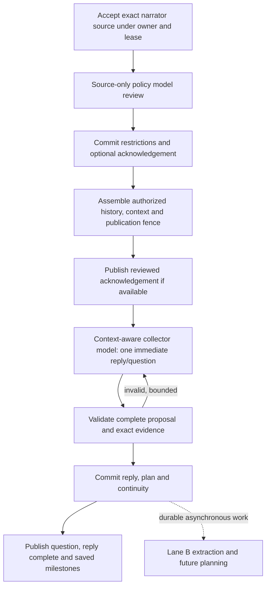

# Lane A: every conversational reply, 22 October 2026

Reviewed application: `29396b6ddd84c5e233f22f4024bc05566cd97abe`, including merged
[PR107](https://github.com/bohui/copyme2.ai/pull/107) and its published receipts.
The dedicated low route and early policy acknowledgement remain disabled in the
shared app. This analysis does not establish issue 53 acceptance.

Lane A already handles **every new generated conversational reply**: opening,
later, resumed, and server-owned conversational actions entering the same runtime.
The fixed introduction and replay of an already saved reply need no model and
are separate cases. The current goal is meaningful text within five seconds,
otherwise ten; question availability, completion, saving and failures must also
be reported for every category. A faster acknowledgement alone is insufficient.

## What changed and why

| Change | Result | Evidence and limit |
| --- | --- | --- |
| Per-generation collector model/effort configuration | Later and pre-existing sessions can use the dedicated same-model low route, with reversible settings. | Exact active gateway policies independently attest pooled/max versus dedicated/low. Requested effort alone is not proof. |
| Kept the existing two lanes and immediate selector | A responds, chooses at most one question, resolves relevant queued questions and chooses `reply_only`/`extract`. B owns events, places, derived profile work and reusable future planning. | A still needs evidence, photo associations, continuity and current intent. It is more than text generation. |
| Transactional publication batching | Required authority setup uses fewer database round trips while retaining locks through actual send. | The earlier component benchmark saved about 25 ms per guarded send; this cannot explain multi-second model delays. |
| Mandatory current-source privacy review | Restrictions commit before older private context may enter model input. | This adds a serial model request to ordinary newly accepted sources. Historical timings before this review are not current acceptance. |
| Optional acknowledgement in that same review | A grounded source-only acknowledgement can be displayed before the context-aware reply, without a third model call. | It waits for review commit, full governed packet preparation and the current publication fence. The collector preserves the displayed text exactly. |
| Complete-proposal validation, corrective runs and transactional save | A private invalid proposal cannot expose its question or report a successful save. | Failures after acknowledgement remain failed exchanges. Repairs can dominate latency. |
| PR107 schema and prompt repairs | Fixed acknowledgements keep their exact enum without a redundant regex; guidance now distinguishes opening invitations, narrow person corrections and whole-exchange stops. | The provider schema interaction was reproduced. Prompt behavior still needs fresh live bilingual acceptance. |
| Evaluation/provenance repairs | Explicit privacy fixtures exercise real policy SQL; reviewed helper bytes are hashed; saved delivery is recorded separately from subsequent assertions. | An all-green mocked matrix proves contracts, not native model quality or production latency. |

## Current critical path

The ordinary newly accepted source has **two serial model requests**, not a new
classifier plus a reply plus an acknowledgement model. A saved replay has no new
generation. An accepted-but-unsaved retry can reuse the exact reviewed source
receipt; pending policy recovery may add work before it proceeds.

The privacy review sees only the current source. It cannot choose a useful
history-aware follow-up. The collector sees the authorized packet and chooses
current intent from the whole narration. Merging these two calls is therefore
an architectural/privacy change, not a safe deletion of redundant classification.

The acknowledgement can reduce perceived silence, but the next input remains
locked until durable saving. A question that arrives at 17 seconds still leaves
a slow conversation even when an acknowledgement arrived at three seconds.

## Where complexity remains

1. **Instruction ownership overlaps.** The active strategy prompt composes shared
   guidance and selection policy, then runtime adds language, continuity and
   two-lane instructions. The English comfort/explore/shape instruction strings
   measure 22,412 / 22,399 / 22,429 characters before evidence, schema and framing.
   The two-lane instructions still say a normal pool is 2–5, while active selection
   explicitly says B owns the future pool. This is a concrete consolidation
   candidate. The old collector-plan prompt is used on the alternate path; it is
   not also appended to active strategy selection.
2. **The wire repeats host-known information.** A representative active schema
   has 11 top-level fields and about 4.6 KB of JSON schema: acknowledgement,
   question, selected candidate, selection reason, strategy, work, associations,
   response photos, stop, question evidence and continuity. Queued question
   resolution adds another field when applicable. Reviewed acknowledgement and
   current source ID/version are already host-known. Photo work is usually
   empty. Generating these again creates formatting/provenance failure risks.
3. **Privacy ownership overlaps.** Dedicated review already commits restrictions,
   but A can propose the same privacy continuity again. A must still respect
   those restrictions. Removing duplicate proposal authority may simplify its
   schema, provided the existing exact-source validation and persistence contracts
   remain intact. People, unresolved references and commitments need a separate
   continuity decision; blindly deferring all of them could harm the next turn
   while B is behind.
4. **Compatibility has a maintenance cost.** `compact-v1`, two-lane fallback and
   active strategy selection have different prompt/schema shapes. Converting
   selection into the existing saved plan is useful compatibility work, but its
   rules should have one owner. Deleting fallback shapes requires checking their
   actual rollout/users and saved-reply behavior first.
5. **Retry layers multiply work.** The application permits three rejected complete
   proposals and one replacement for an incomplete document within its 120-second
   budget. Previous native diagnostics also showed six stream attempts inside a
   single native turn. App invocations are not provider request counts; unavailable
   provider counts remain unavailable. Shortening only the outer deadline could
   increase visible failures without making replies faster.

## Recommended simplification order

| Priority | Concrete change to evaluate | Expected benefit | Required protection |
| --- | --- | --- | --- |
| 1 | Consolidate the active A instructions; remove obsolete future-pool wording and duplicate work/stop rules. Keep each rule in one source. | Fewer contradictions and corrective model runs; smaller reviewed contract. | Full bilingual semantic comparison, with prompt publication only after merge. No promised speedup from character count alone. |
| 2 | Give the model only decisions/evidence it must supply. Bind reviewed acknowledgement and current source identity in the host; omit unavailable photo fields from the generated shape. | Less repeated output and fewer model-generated identity/format errors. | An explicit small wire contract, then strict conversion into the existing complete validated plan. Do not silently repair incorrect supplied coordinates or foreign metadata. |
| 3 | Let source-policy review own restrictive controls once; keep A as their consumer. | Remove duplicate privacy proposals and associated repair triggers. | Current restrictions must still commit before history admission, and current-source receipts, privacy epochs and SQL checks must remain authoritative. |
| 4 | Use one turn deadline and observable retry budget across app/native layers. Diagnose retries by cause before changing limits. | Predictable tails and clearer failure recovery. | Keep useful bounded correction, accepted-source recovery and explicit errors. Never count a timeout or early acknowledgement as success. |
| 5 | Batch only measured independent preparation reads. | Smaller constant overhead on every reply. | Preserve ordering, owner/lease authority and cancellation settlement. This is secondary to model/retry time. |

Keep the two-lane split, dedicated collector configuration, full current testimony,
authorized continuity, semantic work decision, one-question behavior, strict
validation, idempotent saved replay and publication/save fences. These protect
quality or have demonstrated performance value. Avoid another pre-reply model,
name/length heuristic, generic filler or bypassed persistence.

The user selected priority 1: consolidate the Lane A prompt rules first. The
prepared change removes the legacy pool instructions from active selection,
keeps its ordinary-hint priority in the selector, and avoids loading an unused
legacy prompt before replacing it. It also makes runtime and boundary evaluation
use the same active contract. No shared evaluator core or acceptance guard is
changed.

Fresh semantic review exposed why sharing rules matters: the candidate translated
“My sister walked to school with me” as 姐姐, both in the early acknowledgement
and the later question. Its source language was English and the selected reply
language was Chinese. The saved policy receipt confirms that the early policy
acknowledgement introduced the unsupported age. The matched baseline used neutral
姊妹. No supplied previous source established age order. This is a candidate
quality regression despite a successful save and passing structural checks.

The draft therefore moves the duplicated sibling-age and speaker-perspective rules into one managed
narrator-fidelity source shared by both the policy acknowledgement and the collector.
It preserves unspecified age, permits an explicit comparison or quantified gap
for the same person, and keeps singular/plural and exact evidence intact. Separate
policy/collector semantic cases cover neutral siblings, explicit older age,
quantified younger age, another relative's age and the interviewer image-viewing
limitation. The Chinese photo candidate told the storyteller they had not seen
the image, although that limitation belonged to the interviewer. Their definitions
and offline wiring checks do not establish live semantic success. New prompt sources require
review/merge and main-only publication before another live acceptance run.

Priority 2 remains a separate, later wire change. Routing, output fields and retry
limits stay as they are for this first consolidation.

## Observed latency and acceptance status

The last pre-PR107-prompt campaign stopped at 22 of 80 rows: eleven baseline
saves, ten candidate saves, one failed candidate and 58 unexecuted rows. Among
ten matched delivered pairs, first public text fell from 15.822 seconds median
to 2.960 seconds, about 81% faster. Candidate saving was 8.643 seconds median,
17.258 maximum; nine validated candidate questions had an 8.681-second median.

Those are partial delivery observations. A saved Chinese opening omitted its
invitation, and a later correction failed all three validations. A separate
browser run saved its first three exchanges and failed its resumed stop. These
failures and earlier incomplete campaigns remain in
[the current acceptance record](issue53-current-acceptance-20261021.md).

PR107's five new prompt sources are now published and verified: collector-plan
v4, governed-continuity v3, governed-repair/codes v3, policy-review v3 and
strategy/selection v6. `make prompt-check` verified all 90 artifacts. Receipt
commit is `29396b6ddd84c5e233f22f4024bc05566cd97abe`.

The fresh campaign at that exact revision completed **80/80 application rows**
in 1,258.486 seconds: 76 generated turns, four cached replays, 81 native invocations
and 76 direct policy calls. All rows saved, no application failure occurred, and
worker-home removal and task-container stopping were verified. The fixed cap was
100 native plus 80 policy calls, 30 minutes overall, 120 seconds per turn. No
background or judge calls were dispatched. Every current source and unrestricted
saved history was verified in the actual native packet; cached replay made no new
worker dispatch. Application success does not establish semantic acceptance.

Excluding deliberate future rollback generations leaves 36 comparable generated
turns per arm, at the same source revision with matched initial seeds:

| Milestone | Pooled/max median | Dedicated/low + reviewed acknowledgement median | Candidate maximum |
| --- | ---: | ---: | ---: |
| First public text, 36 per arm | 16.925 s | 2.809 s | 10.479 s |
| Validated question, 32 per arm | 20.482 s | 8.627 s | 16.706 s |
| Complete reply, 36 per arm | 18.554 s | 8.650 s | 21.708 s |
| Saved reply, 36 per arm | 18.562 s | 8.660 s | 21.726 s |

Raw first text is about 83% faster, but it includes the two semantically incorrect
candidate replies above. Five story-opening acknowledgements were generic thanks
or a greeting; review counts their later grounded question as the first meaningful
text. Among the other 34 candidate comparisons with no material defect identified,
meaningful text had a 3.165-second median and 10.479-second maximum: 27/34 within
five seconds, 33/34 within ten. The two failed-quality replies remain failed cases,
not successful latency observations. First-turn meaningful median was 7.510 seconds
(11 valid observations plus one failed quality case), later-turn median 2.762
(21 plus one failed quality case), resumed median 2.7825 (two observations).
These small samples are not production percentiles or guarantees. Review was
Codex bilingual inspection, not blinded independent human calibration.

The current-source browser smoke is still **failed**: four sources accepted,
three replies saved, and a resumed stop unsaved. Exact capture now identifies
three repeated proposals that copied stored name “Rowan” into `work.name`, although
the stop source contains no name. Strict current-source validation rejects them;
the generic repair code provides no useful field-specific correction. One earlier
question-evidence span rejection recovered. Browser/API/worker cleanup verified.
Optional readiness 503s and aborted private-draft requests remain separate from
the foreground failure. Native dispatch diagnostics record seven starts and four
policy calls completed; the final budget retrieval failed, so its direct budget
receipt remains unavailable rather than zero. Earlier stream failures and
cancelled/incomplete cohorts remain in the linked historical record.

The prepared consolidation therefore also explains that work.name is a
current-source update, not a stored addressing name, and gives that exact failure
an actionable `CONTRACT_30` repair. It keeps the strict name validator, publication
fences, output schema, routes and retry ceilings. Native acceptance of the changed
prompts remains pending review, merge and main-only publication. Fresh bilingual,
existing-session, long-source, background extraction and browser checks still
precede release. The candidate stays off until these pass.

## Source map

- [Turn orchestration](../apps/api/lifetime_memory_runtime.py): policy before
  private context, active selector, acknowledgement publication, validation/save.
- [Policy review](../apps/api/policy_review.py): bounded source-only controls,
  optional acknowledgement, exact source/version/language reuse.
- [Immediate selection](../apps/api/interview_strategy.py): one question, current
  intent, queued candidate validation and saved-plan adaptation.
- [Continuity](../apps/api/lifetime_memory_continuity.py): exact current evidence,
  strict offsets, full validation and deterministic storage rows.
- [Collector execution](../apps/api/lifetime_memory_engine.py): fresh bounded homes,
  publication admission, immutable acknowledgement and corrective runs.
- [Two-lane contract](../apps/api/two_lane_memory.py): background extraction and
  future hints, with current confirmation precedence.
- [Collector configuration](../apps/api/collector_configuration.py): resolve
  reversible server-owned settings on every generation.

## Prepared-change verification

Seven new failure instances were recorded before implementation: three boundary/
shared-fidelity assertions and three real HTTP/SQL prompt-parity cases plus the
copied-name repair case. After the change, the focused run passes 230 tests and
retains three failures in obsolete preparation tests. Those same three tests fail
on unchanged published main because their legacy harness calls removed
`_resolve_language`; no compatibility shim, skip or weakened assertion was added.
The additional strict continuity/plan/transport run passes 145 tests. The shared
fidelity source check passes all four collector/strategy templates. Required
`make test-place-research` passes **591 JavaScript, 429 API/database and 95
standalone** checks. All isolated-check native cleanup is verified.

This first consolidation reduces the active English instruction string from
22,412 to 22,093 characters for comfort (the other strategies remove the same
319 characters). The reduction is modest: the useful change is one owner for
fidelity and work/selection rules, removal of contradictory pool instructions,
and actionable correction instead of repeating a generic failure. A major
latency gain from this prompt change has not been measured. Privacy review gains
the shared fidelity rule; future native comparisons must include that cost.

The [sanitized evidence](test-evidence/issue53-lane-a-analysis-20261022.json) keeps
current source identity, timings, budgets, all semantic/browser failures, baseline
failures, cleanup and changed-file hashes. Prompt sources remain unpublished on
the feature branch and published receipt files are unchanged. Live acceptance of
this consolidation requires main-only publication; the completed campaign above
measures its published baseline, not this prepared prompt change.
